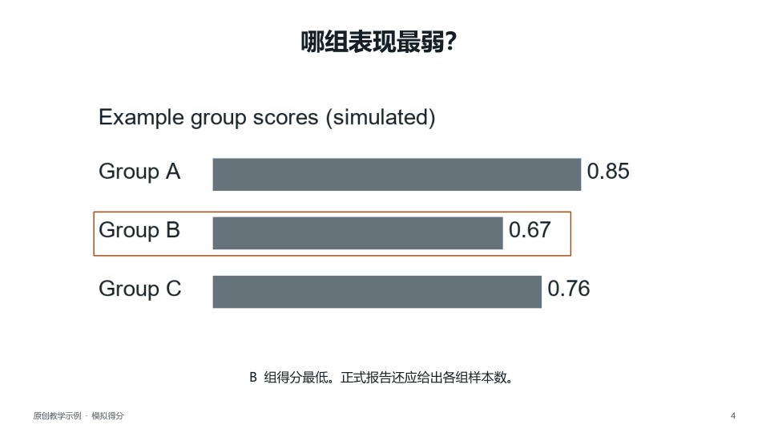

# Research Talk PPT

一个面向中文组会、论文精读和科研进展汇报的 Codex Agent Skill。将论文证据、预裁切图表和演讲笔记整理成以图为主、可编辑的 PowerPoint。支持封面、流程、单图或双图、可编辑表格、讨论和结束页。

页面默认使用白底、居中深色标题和焦橙色局部强调。先为每页挑出最能回答问题的图或分面。引用放在对应页左下角，用一行小号灰字写“作者，年份 · 图表编号”。完整文献、读图说明和口头转场放进演讲者备注。



## 安装到 Codex

将本仓库复制到个人技能目录下的 `research-talk-ppt` 文件夹，使 `SKILL.md` 直接位于该文件夹内。Windows 上通常是 `%USERPROFILE%\.codex\skills\research-talk-ppt`。

然后在 Codex 中输入：

> 用 $research-talk-ppt 把本地论文和这份笔记做成 15 分钟中文组会 PPT。重点讲方法、最强基线和局限，输出可编辑 PPTX。

## 本地运行示例

需要 Python 3.10+。在自己的虚拟环境中运行：

```powershell
python -m pip install "python-pptx>=1.0.2,<2"
python scripts/build_deck.py examples/demo.json demo.pptx
```

JSON 中的相对图片路径以该 JSON 所在目录为基准。[布局与字段说明](references/layouts.md)介绍了双图排法、图中标注和文字强调。可在 PowerPoint 中修改文字、流程和备注，替换图像对象。论文插图的内部细节由其原始文件格式决定。导出 PDF 或逐页预览可用 PowerPoint 或 LibreOffice。模板使用 Microsoft YaHei，缺少该字体时请检查替代字体的换行。

叙事参考 Heqin Zhu 的 structRFM 学术报告。仓库提供原创版式与示例，参考 PDF、机构标识和论文配图由使用者在本地按需提供。
